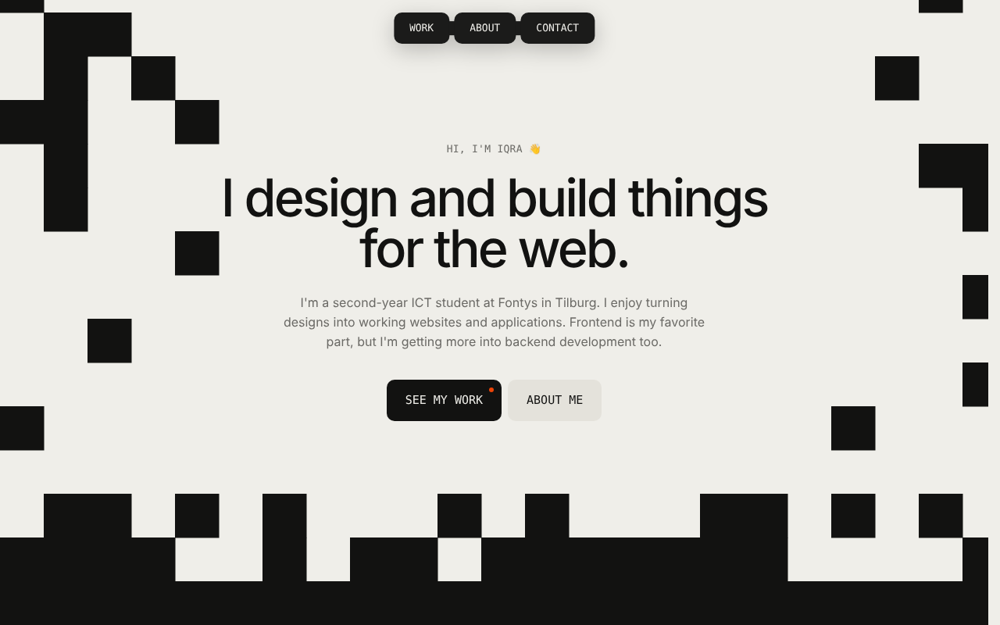

# Iqra Farah – portfolio

Hi, I'm Iqra 👋 I'm a second-year ICT student at Fontys in Tilburg, and this is my portfolio.
It shows the websites and apps I've made during internships, at school and in my free time. Every project has its own page that explains what it was and what I did.



## Tech stack

| What | Used for |
| --- | --- |
| [Nuxt 3](https://nuxt.com) (Vue 3, TypeScript) | The site and the project pages, generated as a static site |
| [Tailwind CSS](https://tailwindcss.com) | Styling |
| [GSAP](https://gsap.com) + ScrollTrigger | Slide-up animations and the pixel effects |
| [Lenis](https://lenis.darkroom.engineering) | Smooth scrolling |
| JSON files in `data/` | All text and projects, so I can change content without touching the code |

## Set-up

1. Install the dependencies

   ```bash
   npm install
   ```

2. Start the dev server on http://localhost:3000

   ```bash
   npm run dev
   ```

## Build for production

1. Make a static site in `.output/public`

   ```bash
   npm run generate
   ```

2. Look at it locally (optional)

   ```bash
   npm run preview
   ```

To host the site in a sub-folder (for example GitHub Pages), set `NUXT_APP_BASE_URL=/your-repo/` before you run `npm run generate`.

## Colour codes

| Colour | Name | Hex | Used for |
| --- | --- | --- | --- |
|  | Beige | `#efeee9` | Page background (hero and contact) |
|  | Beige 2 | `#e4e2db` | Light buttons ("About me", "Copy email") |
|  | Beige 3 | `#d3d2cc` | Light buttons on hover |
|  | Ink | `#121211` | Text, buttons, the dark Work section, About drawer |
|  | Ink 2 | `#1b1b1a` | Picture backgrounds on the dark pages |
|  | Ink 3 | `#262625` | Button hover on dark, tags on the cards and case pages |
|  | Mute | `#6b6a66` | Grey text on the light background |
|  | Orange | `#ed4407` | The one accent: dots, flashes, focus outline, text selection |

The colours are set in `tailwind.config.ts` and used as classes, for example `bg-ink`, `text-beige` and `text-orange`.

## Fonts

- **Geist** for text and headings
- **Geist Mono** for small labels and buttons (uppercase)

Both are loaded from Google Fonts in `nuxt.config.ts`.

## Changing the content

- `data/work.json`: the projects and the text of every case study. Only `slug` and `title` are required. Anything you leave out is simply not shown. The `card` field sets the shape of the card (`wide`, `medium`, `tall` or `square`).
- `data/profile.json`: email, links, About text, jobs and the tech stack.
- `data/icons.json`: the logo shapes for the tech stack.
- `public/images/`: screenshots, videos and logos.

To change the order of the projects, change the order in `data/work.json`.

## Project structure

```
assets/css/       global styles
components/       sections and small parts (hero, work cards, About drawer, ...)
composables/      shared logic (smooth scroll, pixel reveal, hover panel, ...)
data/             content as JSON
pages/            home page and the case study page (/work/<slug>)
public/           images and favicon
tailwind.config.ts  colours and fonts
```

## Details

- A pixel wall opens when the site loads, and the hero has black pixels behind it.
- Project screenshots appear as big pixels that get sharper when they scroll into view.
- Everything respects "reduce motion" in the device settings.
- The site is fully static, so it loads fast and can be hosted anywhere.
